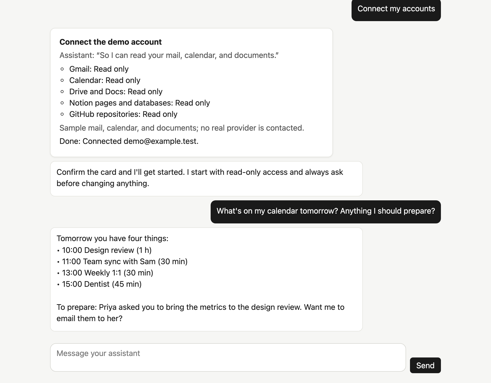
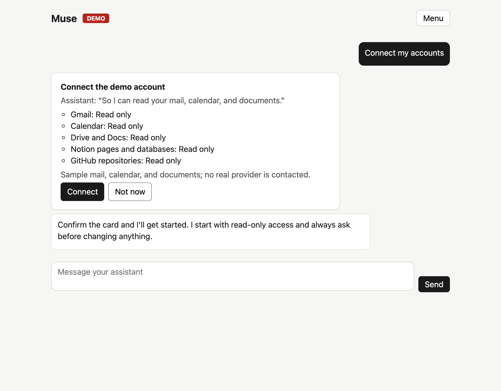
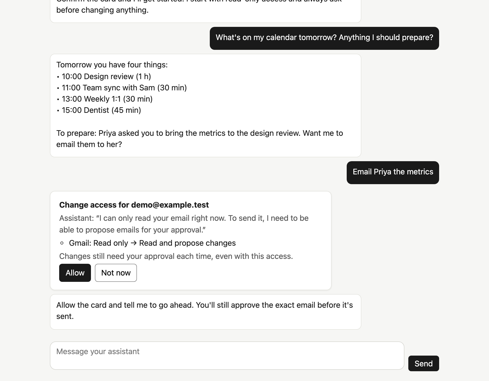
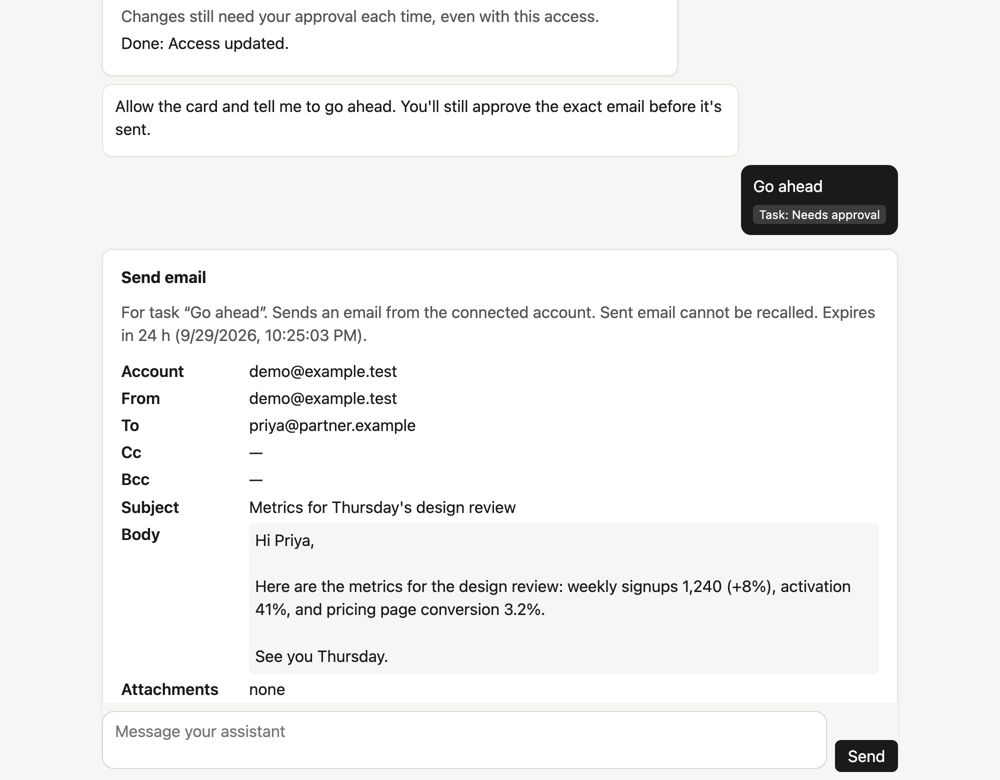
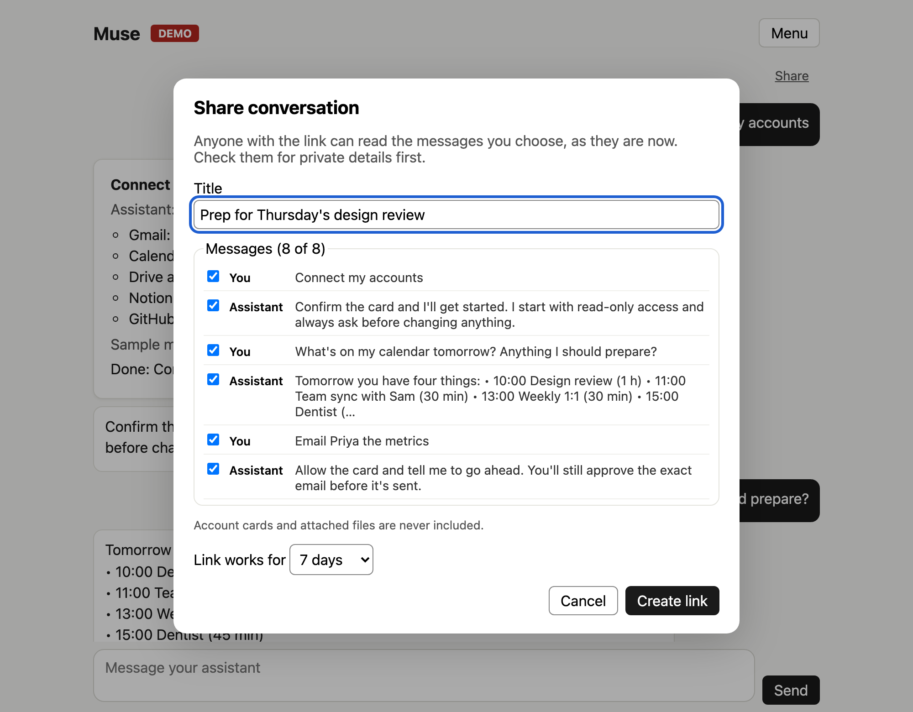
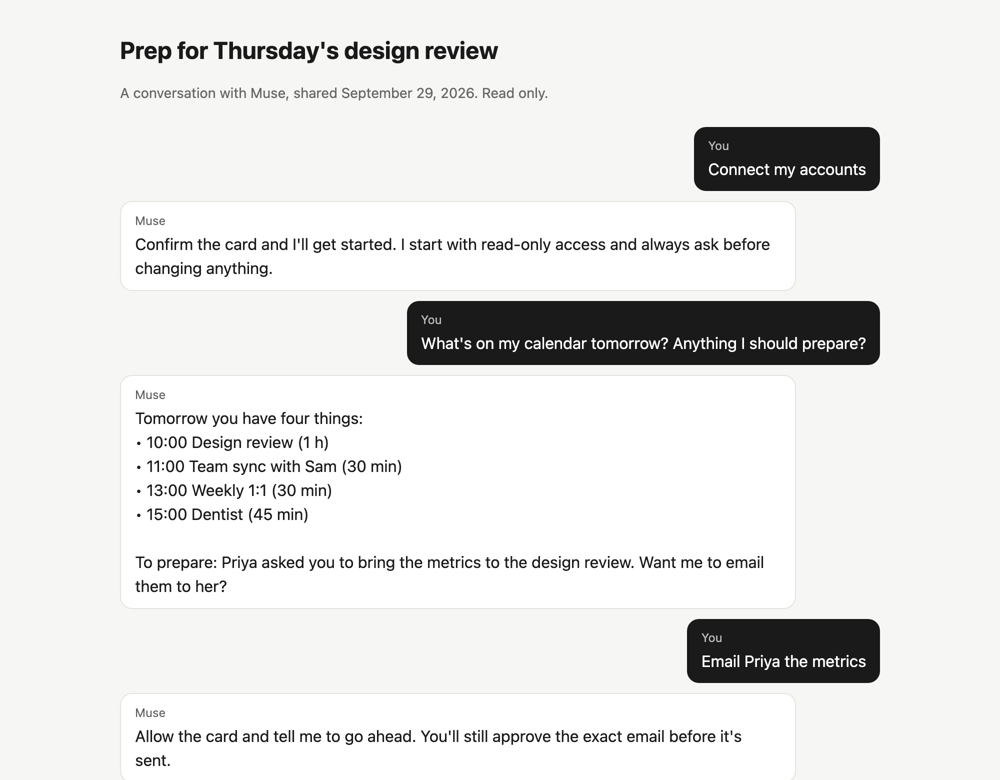
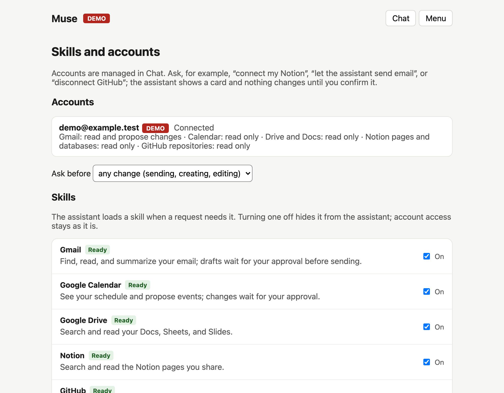

<div align="center">

# ✨ OpenMuse

### 你的私人 AI 助理 —— 开源、自托管、每一步都先问你。
### Your personal AI agent — open source, self-hosted, and it asks before it acts.

**⚡ 用 [LingCode](https://lingcode.dev) 一个周末从零做完 · Built from scratch in one weekend with [LingCode](https://lingcode.dev) ⚡**

[](LICENSE)


[](https://lingcode.dev)

**[中文](#zh) · [English](#en)**



</div>

---

<a id="zh"></a>


### 💡 OpenMuse 是什么？

OpenMuse 是一个**跑在你自己机器上的私人 AI 助理**。你只需要**聊天**：让它看你的日程、读邮件、翻 Google Drive / Notion / GitHub、写简报、定时提醒、上网查资料 —— 连「连接账号」这件事本身，也是在对话里完成的。

而最重要的一点：**它永远不会背着你做事。** 发邮件、改日程、扩大权限，每一步都会在聊天里弹出一张卡片，写清楚**到底要做什么**，等你点「允许」才执行。

### ⚡ 一个周末，用 LingCode 从零到能用

整个项目 —— 需求、技术设计、后端、前端、测试、发布流程 —— **用 [LingCode](https://lingcode.dev) 在一个周末里完成**。不是一个玩具 Demo，而是一套带着完整工程纪律的系统：

| | |
|---|---|
| 🐍 **约 12,000 行** Python 后端 | FastAPI · PostgreSQL · 6 个相互隔离的服务 |
| ⚛️ **约 1,900 行** React 前端 | 聊天优先，无障碍（axe-core）自动检查通过 |
| 🧪 **269 个自动化测试** | 外加「变异测试」：故意把安全规则改坏，确认测试一定能抓到 |
| ✅ **10/10 发布关卡** | 锁定依赖、代码检查、数据库迁移、密钥扫描、浏览器冒烟测试、全新安装…… |
| 🧩 **10 个技能（Skills）** | Gmail · 日历 · Drive · Notion · GitHub · 文件 · 记忆 · 自动化 · 浏览器 · 每日简报 |

### 📸 

| 在聊天里连接账号 | 权限升级也要你同意 | 发邮件前逐字确认 |
|:---:|:---:|:---:|
|  |  |  |
| **一键分享对话快照** | **别人看到的只读页面** | **技能与账号一览** |
|  |  |  |

### 🧩 

- **💬 聊天就是一切** —— 连接、修改权限、重新登录、断开账号，全部在对话里说一句就行；确认卡片直接出现在聊天中。
- **📧 Gmail / 📅 Google 日历** —— 搜索、阅读、总结；起草邮件和日程变更，你批准后才发送。
- **📂 Google Drive · 📝 Notion · 🐙 GitHub** —— 只读访问文档、页面、数据库、仓库、Issue 和 PR。
- **🧠 技能系统** —— 每项能力都是一个 `SKILL.md`，按需加载；你也可以用纯文字写自己的技能（例如「每周回顾」），无需写代码。
- **⏰ 自动化** —— 「每个工作日早上 8 点提醒我看邮件」「日历一变就告诉我」，确认后才生效。
- **📄 文件与记忆** —— 生成 Markdown / CSV / PDF；只记住你明确要求它记住的事。
- **🌐 隔离浏览器** —— 只能访问公网页面，不能登录、不能提交表单；可以实时观看、随时接管。
- **🔗 分享** —— 把选中的消息生成只读快照链接，可设 1 / 7 / 30 天有效，随时关闭。
- **🗂️ 你的数据归你** —— 一键导出全部数据、一键彻底删除、备份与恢复。

### 🔒 安全设计（不是口号）

- **每一次对外写入都要你亲手批准**，批准的是**精确内容**（收件人、正文、附件都绑定哈希），24 小时过期，不可重放。
- **AI 自己不能给自己加权限**：它只能「申请」，只有你登录后的点击才能生效；降低权限则立即生效。
- **邮件、网页、文件里的内容一律视为不可信**，不会被当作指令执行。
- **密钥只在 broker 进程里**，加密存储；AI 所在的 worker 进程连不上外网，只能访问模型接口。
- **分享链接只存哈希**，页面不含任何脚本和 Cookie，不被搜索引擎收录，过期或关闭即删除内容。

### 🚀 快速开始（演示模式，无需任何账号或 API Key）

**需要：** [uv](https://docs.astral.sh/uv/)、Node 20+（含 npm）。数据库会自动内嵌启动，不用另装。

```sh
git clone https://github.com/SubjectAlphaChisato/OpenMuse.git openmuse && cd openmuse

# 1. 安装（版本全部锁定）
cd server
uv sync --frozen --extra dev --extra browser
.venv/bin/playwright install chromium
cd ../web
npm ci
npm run build
cd ..

# 2. 运行 —— 一条命令启动数据库和全部服务
npm run dev          # 或者：node scripts/dev.mjs
```

打开 **http://127.0.0.1:8080**，用 `demo@example.com` / `demo-password-123` 登录，然后在聊天里说「**Connect my accounts**」试试。按 `Ctrl-C` 停止；数据保存在 `server/data/`。

> 演示模式使用示例邮箱、日历和文档，助理的回复是预设脚本，**不会连接任何真实服务**。在 LingCode 里直接点 **Run** 也能启动。

### 🔌 使用真实账号和 Claude

1. 复制配置：`cp .env.example .env`
2. 设置 `OPA_MODE=live`、`OPA_MODEL_PROVIDER=anthropic`，并填入 `OPA_ANTHROPIC_API_KEY`。
3. 按需填写 Google / Notion / GitHub 的 OAuth 凭据（详细步骤见 [运维指南](docs/OPERATIONS.md)）。
4. 用 Docker Compose 部署（见下一节），然后在聊天里说「连接我的 Google 账号」。

### ☁️ 部署（Docker Compose）

在任何装有 Docker 的机器上：

```sh
cp .env.example .env                 # 设置三个数据库密码和 OPA_INTERNAL_TOKEN
server/.venv/bin/opa generate-kek    # 把输出填入 .env 的 OPA_BROKER_KEK
docker compose --env-file .env -f deploy/compose.yaml up --build -d
docker compose --env-file .env -f deploy/compose.yaml run --rm api opa bootstrap-owner you@example.com
```

服务默认只监听 `127.0.0.1:8080`。要从外网访问（例如分享链接给别人），请放在 **HTTPS 反向代理**后面，并设置 `OPA_SECURE_COOKIES=true` 和 `OPA_PUBLIC_BASE_URL=https://你的域名`。备份、恢复、升级等见 [运维指南](docs/OPERATIONS.md)。

### 📊 项目状态：v0.2 预览版

诚实地说：所有功能都通过了自动化测试，但**真实的 Google、Notion、GitHub 和 Claude 接口还没有做过线上验证**（测试使用的是按官方文档实现的模拟服务），**Docker Compose 部署也还没有在真实 Docker 环境中跑过**。详见 [IMPLEMENTATION_STATUS.md](IMPLEMENTATION_STATUS.md)。欢迎试用、提 Issue、贡献代码！

### 📚 文档

[运维指南](docs/OPERATIONS.md) · [技能开发](docs/skills.md) · [技术设计](docs/tech-design.md) · [需求规格](docs/open-muse-implementation-requirements.md) · [更新日志](CHANGELOG.md) · [参与贡献](CONTRIBUTING.md)

---

<a id="en"></a>

## 🇺🇸 English

### 💡 What is OpenMuse?

OpenMuse is a **personal AI agent that runs on your own machine**. You just **chat**: it reads your calendar and email, digs through Google Drive, Notion, and GitHub, writes briefs, sets reminders, and looks things up on the web. Even *connecting your accounts* happens in the conversation.

And the part that matters most: **it never acts behind your back.** Sending an email, changing an event, or asking for more access always shows up as a card in the chat that says **exactly** what will happen, and nothing happens until you click Allow.

### ⚡ Built from scratch in one weekend with LingCode

The whole project (requirements, technical design, backend, frontend, tests, and release tooling) was **built with [LingCode](https://lingcode.dev) in one weekend**. Not a toy demo, but a system with real engineering discipline:

| | |
|---|---|
| 🐍 **~12,000 lines** of Python backend | FastAPI · PostgreSQL · six isolated services |
| ⚛️ **~1,900 lines** of React frontend | chat-first, passes automated accessibility checks (axe-core) |
| 🧪 **269 automated tests** | plus mutation checks: each safety rule was deliberately broken to prove a test catches it |
| ✅ **10/10 release gates** | locked dependencies, lint, migrations, secret scan, browser smoke test, fresh install, and more |
| 🧩 **10 skills** | Gmail · Calendar · Drive · Notion · GitHub · Files · Memory · Automations · Browser · Daily brief |

### 📸 Screenshots

| Connect accounts in chat | Wider access needs your OK | Approve the exact email |
|:---:|:---:|:---:|
|  |  |  |
| **Share a conversation snapshot** | **What the recipient sees** | **Skills and accounts** |
|  |  |  |

### 🧩 What it does

- **💬 Chat is the interface.** Connect, change access, reconnect, or disconnect an account by asking; the confirmation card appears right in the conversation.
- **📧 Gmail / 📅 Google Calendar.** Search, read, and summarize; draft emails and event changes that are sent only after you approve them.
- **📂 Google Drive · 📝 Notion · 🐙 GitHub.** Read-only access to documents, pages, databases, repositories, issues, and pull requests.
- **🧠 Skills.** Every capability is a `SKILL.md` loaded on demand. Write your own in plain text (say, a "weekly review"), no code needed.
- **⏰ Automations.** "Remind me every weekday at 8:00 to review email", "tell me when my calendar changes"; nothing runs until you confirm it.
- **📄 Files and memory.** Generates Markdown, CSV, and PDF; remembers only what you explicitly ask it to.
- **🌐 An isolated browser.** Public web pages only, no sign-ins or forms; watch it live and take control at any time.
- **🔗 Sharing.** Turn chosen messages into a read-only snapshot link that lasts 1, 7, or 30 days, and turn it off whenever you like.
- **🗂️ Your data stays yours.** One-click export, one-click delete-all, and backup and restore.

### 🔒 Security by design

- **Every external write needs your explicit approval** of the **exact** content (recipients, body, and attachments are bound by hash). Approvals expire after 24 hours and cannot be replayed.
- **The AI cannot grant itself access.** It can only *ask*; only your signed-in click makes it happen. Reducing access applies at once.
- **Email, web pages, and files are treated as untrusted data**, never as instructions.
- **Credentials live only in the broker**, encrypted at rest. The worker that runs the AI has no internet route except to the model API.
- **Share links are stored only as hashes.** The page has no scripts or cookies, stays out of search engines, and its content is deleted when the link expires or is turned off.

### 🚀 Quick start (demo mode: no accounts or API keys needed)

**Requires** [uv](https://docs.astral.sh/uv/) and Node 20+ with npm. The database is embedded and starts automatically.

```sh
git clone https://github.com/SubjectAlphaChisato/OpenMuse.git openmuse && cd openmuse
```

**1. Install** (every version is locked; the release check runs this block verbatim in an empty copy of the repository):

<!-- fresh-install:begin -->
```sh
cd server
uv sync --frozen --extra dev --extra browser
.venv/bin/playwright install chromium
cd ../web
npm ci
npm run build
cd ..
```
<!-- fresh-install:end -->

**2. Run** (one command starts the database and every service):

```sh
npm run dev          # or: node scripts/dev.mjs
```

Open **http://127.0.0.1:8080**, sign in with `demo@example.com` / `demo-password-123`, and say "**Connect my accounts**" in the chat. Press `Ctrl-C` to stop; your data is kept in `server/data/`.

> Demo mode uses a sample mailbox, calendar, and documents, and the assistant's replies are scripted; **no real service is contacted**. In LingCode, just press **Run**.

### 🔌 Use real accounts and Claude

1. Copy the settings: `cp .env.example .env`
2. Set `OPA_MODE=live` and `OPA_MODEL_PROVIDER=anthropic`, and fill in `OPA_ANTHROPIC_API_KEY`.
3. Add OAuth credentials for Google, Notion, or GitHub as needed (step by step in the [operations guide](docs/OPERATIONS.md)).
4. Deploy with Docker Compose (next section), then say "connect my Google account" in the chat.

### ☁️ Deploy (Docker Compose)

On any machine with Docker:

```sh
cp .env.example .env                 # set the three database passwords and OPA_INTERNAL_TOKEN
server/.venv/bin/opa generate-kek    # paste the output into OPA_BROKER_KEK in .env
docker compose --env-file .env -f deploy/compose.yaml up --build -d
docker compose --env-file .env -f deploy/compose.yaml run --rm api opa bootstrap-owner you@example.com
```

The app listens on `127.0.0.1:8080` only. To reach it from elsewhere (for example, so people can open your share links), put it behind an **HTTPS reverse proxy** and set `OPA_SECURE_COOKIES=true` and `OPA_PUBLIC_BASE_URL=https://your-domain`. Backups, restore, running the services yourself, and upgrades are in the [operations guide](docs/OPERATIONS.md).

### 📊 Status: v0.2 preview

To be straight about it: every feature passes the automated tests, but **the real Google, Notion, GitHub, and Claude APIs have not been exercised live yet** (tests use fakes built to the providers' published contracts), and **the Docker Compose deployment has not yet been run on a real Docker host**. Details in [IMPLEMENTATION_STATUS.md](IMPLEMENTATION_STATUS.md). Try it, open issues, and send pull requests!

### 📚 Docs

[Operations guide](docs/OPERATIONS.md) · [Writing skills](docs/skills.md) · [Technical design](docs/tech-design.md) · [Requirements](docs/open-muse-implementation-requirements.md) · [Changelog](CHANGELOG.md) · [Contributing](CONTRIBUTING.md)

---

<div align="center">

**OpenMuse** is an independent open-source project. It is not affiliated with or endorsed by Meta, and it is not an implementation of any Meta product.
OpenMuse 是独立的开源项目，与 Meta 无关联，也未获其认可或背书。

Apache-2.0 · Made with ❤️ and [LingCode](https://lingcode.dev)

</div>
